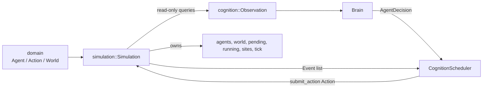

# Architecture

## Current architecture at a glance

The crate has three current layers: domain data, an authoritative simulation, and cognition orchestration. [`lib.rs`](../src/lib.rs) exposes all three. The design boundary is ownership: only `Simulation` owns mutable physical state; cognition creates snapshots and submits proposals.



The arrows are intentionally one-way for mutation: neither `Brain` nor `CognitionScheduler` owns a mutable `World` or mutable `Agent` reference.

## Module boundaries

| Module | Current responsibility | Does not own or implement |
| --- | --- | --- |
| [`domain`](../src/domain/mod.rs) | Typed values: agent identity/state, actions, positions, world data. | Tick logic, validation, provider calls, I/O. |
| [`simulation`](../src/simulation/mod.rs) | Command acceptance, tick sequencing, survival changes, multi-tick activity completion, events. | LLM calls, rendering, persistence. |
| [`cognition`](../src/cognition/mod.rs) | Observation construction, brain contract/DTOs, async scheduling, provider adapter/test brain. | Direct physical world mutation. |
| [`main.rs`](../src/main.rs) | Bounded headless demonstration loop. | A production server, persistence loop, or renderer. |

### Domain boundary

[`agent.rs`](../src/domain/agent.rs) defines `Agent` and physical `AgentState`; its `Activity` says only what ongoing work exists. [`action.rs`](../src/domain/action.rs) defines commands including move, gather, eat, build, speak, give resources, and rest. [`world.rs`](../src/domain/world.rs) defines positions, bounds, resource nodes, and the world containers. The types are data-only.

`Shelter` contains `builder`, but the active `World` stores `BTreeSet<Position>` shelter locations. That is the current source shape; there is no implemented shelter ownership/occupancy behavior.

### Simulation ownership and tick flow

[`Simulation`](../src/simulation/engine.rs) privately owns `World`, `BTreeMap<AgentId, Agent>`, pending actions, private `Running` records, construction sites, and tick number. It exposes read-only `world`, `agent`, `agents`, `position`, eligibility, and plausible-action query methods for callers such as cognition.

```mermaid
sequenceDiagram
  participant Caller
  participant Sim as Simulation
  participant World
  Caller->>Sim: submit_action(agent, action)
  Sim-->>Caller: None or ActionRejected
  Caller->>Sim: tick()
  Sim->>Sim: increment tick; take pending in AgentId order
  Sim->>Sim: validate/start actions; set Activity
  Sim->>Sim: update hunger, energy, health
  Sim->>World: complete move/gather/build effects
  Sim-->>Caller: Vec<Event>
```

At start, the engine rejects unknown/busy/duplicate-pending agents. `tick()` starts pending actions, applies survival effects, and advances running activities. Events in [`event.rs`](../src/simulation/event.rs) report starts, completions, gathering, shelter construction, eating, rejection, and threshold crossings. Rules are explicit values in [`rules.rs`](../src/simulation/rules.rs).

Gathering validates a matching nonempty node when work starts and revalidates on completion; building deducts wood/reserves a site at start, then makes a shelter at completion. `Speak` and `GiveResources` are currently rejected as unsupported. These semantics are exercised by focused engine tests in [`engine.rs`](../src/simulation/engine.rs).

### Cognition boundary and synchronized barrier

`Observation::from_simulation` ([`observation.rs`](../src/cognition/observation.rs)) reads an eligible agent's data and constructs an owned, radius-limited snapshot. It includes nearby agents/resources/shelters and the engine's current plausible-action names. This is the value passed across asynchronous work, so the scheduler does not retain a simulation borrow across an await.

`Brain` ([`brain.rs`](../src/cognition/brain.rs)) accepts that snapshot and returns `AgentDecision`; `DecisionAction` is a provider-facing DTO translated to a domain `Action` in [`decision.rs`](../src/cognition/decision.rs). [`CognitionScheduler`](../src/cognition/scheduler.rs) owns a small per-agent `Slot` state machine, a semaphore, and the shared brain. It has no mutable-world capability beyond accepting `&mut Simulation` at its boundary method.

```mermaid
sequenceDiagram
  participant Loop
  participant Scheduler as CognitionScheduler
  participant Brains as Tokio Brain tasks
  participant Sim as Simulation
  Loop->>Scheduler: resolve_required(&mut Sim)
  Scheduler->>Sim: snapshot all eligible observations in AgentId order
  Scheduler->>Brains: start bounded concurrent requests
  Note over Loop,Sim: No Simulation::tick while the barrier awaits
  Brains-->>Scheduler: decisions/errors/timeouts, any completion order
  Scheduler->>Scheduler: collect/apply in AgentId order
  Scheduler->>Sim: submit_action(proposals)
  Scheduler-->>Loop: response/rejection events
  Loop->>Sim: tick()
  Sim-->>Loop: tick events
  Loop->>Scheduler: observe_events(events, tick)
```

At a boundary, `resolve_required` first snapshots every eligible `NeedsDecision` agent from one unchanged state. It assigns one monotonically increasing request ID per agent, starts all requests, then awaits every task. A semaphore bounds concurrent brain calls and Tokio `timeout` bounds a call's wall-clock duration. Responses are gathered in a `BTreeMap<AgentId, _>` and submitted in its sorted order, so asynchronous arrival order does not determine engine mutation order.

Slots are `NeedsDecision`, `Outstanding { request_id }`, `Resolved`, or `Cooldown { eligible_at_tick }`. A result must match the current outstanding ID and the engine must still consider the agent eligible. The barrier does not retain a background channel, long-lived request task, or separate stale-generation mechanism after it completes. Successful submissions become `Resolved`; failure and rejection use `Cooldown`. Completion and eating events prepare a fresh decision; a rejection wins if both signals appear together.

`eligible_at_tick` is simulation-time cooldown state. Tokio `timeout` bounds the duration of a brain call in wall-clock time. This separation means a slow provider delays the loop in real time but does not make `tick_count`, needs, or activities advance while waiting. [`OpenAiBrain`](../src/cognition/openai.rs) contains Responses API-specific prompt/schema/parsing behavior; [`DeterministicTestBrain`](../src/cognition/test_brain.rs) supplies delayed scripted behavior for tests/demo.

## Current runtime example

[`main.rs`](../src/main.rs) creates two agents, a delayed deterministic brain, and a scheduler. On each of eight iterations it prints a barrier start, awaits `resolve_required`, prints a barrier end with elapsed wall time and unchanged tick count, ticks the simulation once, observes events, prints results, and sleeps. The environment variable `EMERGENCE_TICK_INTERVAL_MS` controls the sleep and defaults to 50 ms. This demonstrates bounded concurrent cognition with a synchronized simulation boundary, not a durable simulation runtime.

## Deferred or not current

No source currently implements relationships, memory, conversation execution, resource transfer, action cancellation/interruption, streaming, retry policy beyond cooldown, terrain/collision/pathfinding, respawn, death/removal, persistence, rendering, or live OpenAI integration tests. The barrier intentionally does not solve provider fairness, cancellation, or throughput beyond a semaphore; its implemented guarantee is that cognition latency does not advance simulation time. Future work should preserve the engine-authority and provider-independent-brain boundaries above.
