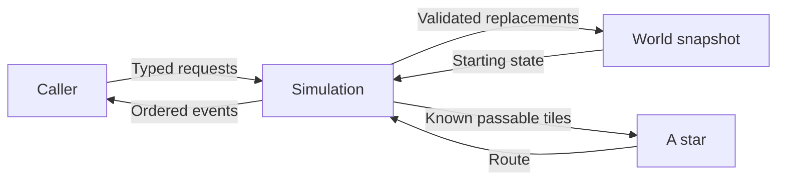
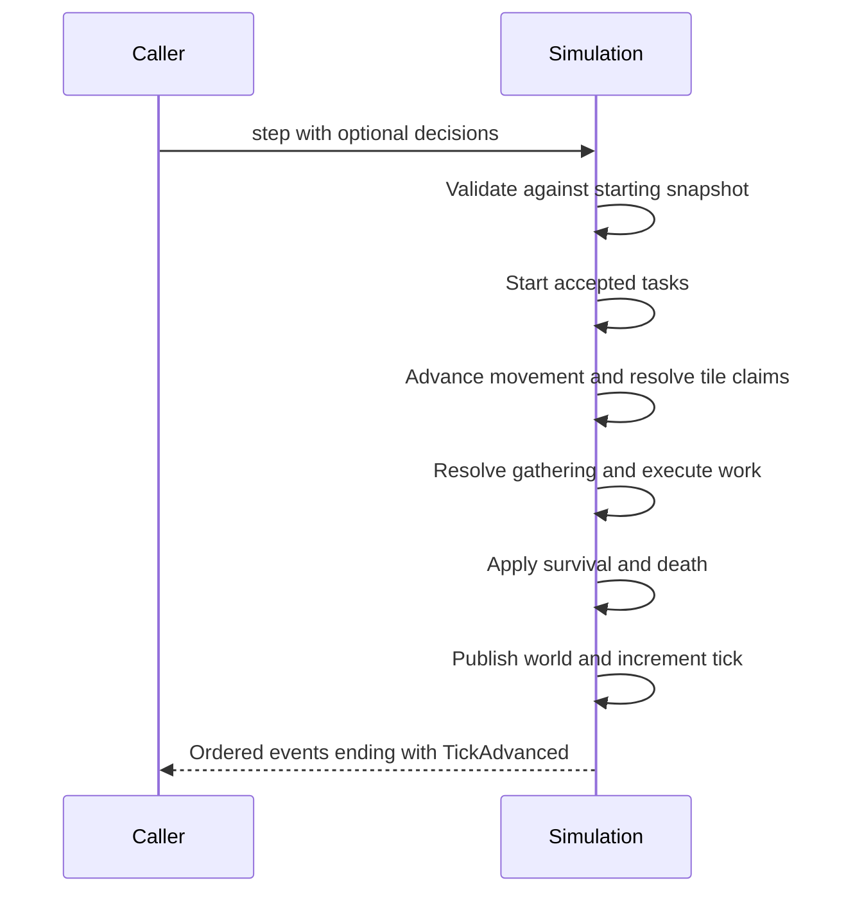

# Architecture

M2 implements an in-memory world and deterministic simulation. A caller supplies a grid and agents, submits requests, and advances ticks. Cognition, orchestration, networking, and visualization are planned; [the roadmap](ROADMAP.md) defines their scope.

## Current layout and authority

| Package | Responsibility |
| --- | --- |
| `domain/` | Strict, frozen Pydantic values, agents, capability catalog, requests, task progress, and events. |
| `world/` | Validated rectangular grid, terrain, resource sources, shelters, agents, tick, and square visibility. |
| `simulation/engine.py` | Owns the world snapshot; validates requests, resolves conflicts, executes tasks, and applies survival. |
| `simulation/rules.py` | Configurable numeric effects and visibility radius. Inventory costs come from the shared capability catalog. |
| `simulation/pathfinding.py` | Deterministic cardinal A* over supplied passability knowledge, independent of world access. |

The engine owns changes. Frozen snapshots remain usable after later ticks; updates reconstruct validated records rather than mutating published objects. `model_copy(update=...)` bypasses validation and is not the update path. Structural validation checks types and bounds; engine validation checks whether an action is executable.

## World rules

Tiles are row-major: index `y * width + x`. Grass and forest are passable when source-free; water blocks movement. Any resource source blocks occupancy. Gathering the last unit removes the source permanently, opening grass/forest tiles. Water remains blocked. There is no regeneration or procedural world generation.

Only one agent occupies a tile. IDs are unique and snapshots sort agents by ID. A dead agent stays in place and still blocks the tile. Shelters occupy resource-free grass, remain walkable, and have no ownership system.

All needs improve upward on 0–100: hunger 0 means starving and 100 full; energy 0 exhausted; health 0 dead. Default effects are:

| Rule | Effect before end-of-tick survival |
| --- | --- |
| Move | One cardinal step; costs 1 energy. |
| Gather | One food/wood from a cardinally adjacent source; costs 2 energy. |
| Eat | Costs 1 food; restores 25 hunger. |
| Rest | Restores 10 energy, or 15 on a shelter tile. |
| Build shelter | Current resource-free grass tile without a shelter; costs 5 wood and 5 energy. |
| Survival | Every living agent loses 1 hunger and 1 energy. After loss, zero hunger causes 2 health damage and zero energy adds 1. |

Need values clamp to 0–100. Rejected actions spend no action costs, but ordinary survival still occurs. There is no healing or revival.

## One tick

`step()` advances even with no decisions. It returns typed facts such as `TaskStarted`, `AgentMoved`, `ResourceDepleted`, `ActionRejected`, `MovementWaiting`, and `NeedsChanged`. Gather/eat/rest/build complete in their acceptance tick; movement can span ticks. Completed/failed task records remain attached until replaced. Active or suspended tasks reject new requests; suspension policies are not implemented.

## Travel and knowledge

`Move(destination)` accepts an initially visible, passable target other than the current tile. A target occupied by a stationary or ineligible agent is rejected; an eligible concurrent mover can vacate it. Default visibility is a square of radius 3, clipped to the grid; it includes diagonals and has no line-of-sight occlusion. A terrain route must exist within the initial visible area.

The task stores its remaining route and passable tiles observed during this journey. Each tick refreshes the currently visible area and retains previously observed passability outside it. General exploration memory across journeys is deferred. A* cannot read hidden terrain; the engine checks actual movement against the authoritative world.

When a route's next step is blocked, deterministic A* attempts a new route avoiding visible stationary occupants. Eligible movers can participate in simultaneous movement. The destination stays unchanged. If no route is currently available, the agent waits and retries without another decision or a blocked-tick failure limit. Waiting spends no movement energy, but survival continues: exhaustion or death can fail the task.

Movement applies atomically: following, swaps, and closed cycles succeed when every needed occupant successfully leaves. Competing claims receive one seeded lottery per destination. The engine then repeatedly removes winners whose destination occupant will not move; it neither rerolls nor promotes lottery losers. Blocked incoming agents wait, preserving their tasks without movement energy costs. The published world always has unique occupancy.

## Reproducibility and planned growth

Decisions use agent-ID order. Contested positions use row/column order; contenders are sorted by ID before equal-weight seeded selection. A private `random.Random(seed)` is used only when claims exceed capacity: movement into the same tile, or gathering more units than a source holds. Losers keep movement tasks or receive gather task failure without action costs. Exclusive occupancy prevents simultaneous shelter claims on agents' current tiles.

Repeatable execution requires the same initial state, seed, decisions, and rules in the same environment. Serialized world snapshots contain state but do not capture private RNG state for checkpoint restoration. No replay persistence is implemented.

Future cognition proposes requests and maintains descriptive intention text. Runtime will coordinate cognition barriers, timeouts, and pacing. Server will transport authoritative snapshots/controls through versioned WebSockets; React/Canvas will display them. These components are absent today. Simulation ticks measure rules independently of wall-clock time. See [decisions](DECISIONS.md) and [the guide](GUIDE.md) for rationale and examples.
